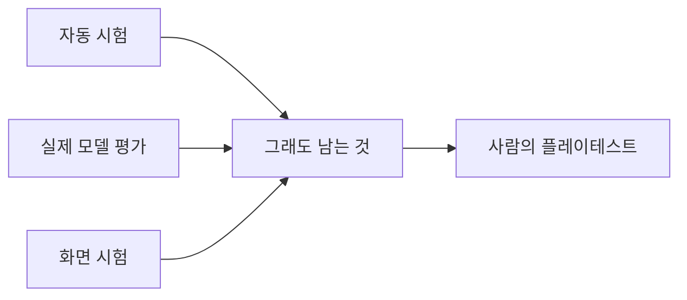

# 검증 체크리스트

폴더명은 `vaildates`(validate 의미)다. **철자를 "교정"하지 않는다** — 이 이름을 그대로 유지한다.

기능·배포 전 **체크리스트와 결과**를 남기는 곳. pytest/Jest 같은 자동 테스트 전략은 [../plan/TESTING.md](../plan/TESTING.md)에 있고, 여기는 **수동 검증·데모 전 체크** 쪽이다.

| 파일 | 내용 |
|------|------|
| [mvp-checklist.md](mvp-checklist.md) | v1 성공 조건 + 플레이테스트 10문항 (계획서 §9.1, §14) |

월드코퍼챗 플레이테스트 항목은 [mvp-checklist.md](mvp-checklist.md) "월드코퍼챗 플레이테스트"(2026-11-06).

<!-- logic-structure -->
## 로직 구조

```text
자동 시험 (코드가 확인) ──────────┐
실제 모델 평가 (evals) ───────────┼─▶ 그래도 남는 것 = 사람이 직접 해 보는 플레이테스트 (이 폴더)
화면 시험 (e2e, 가짜 LLM) ────────┘
```

<!-- logic-mermaid -->

### 확인의 층


