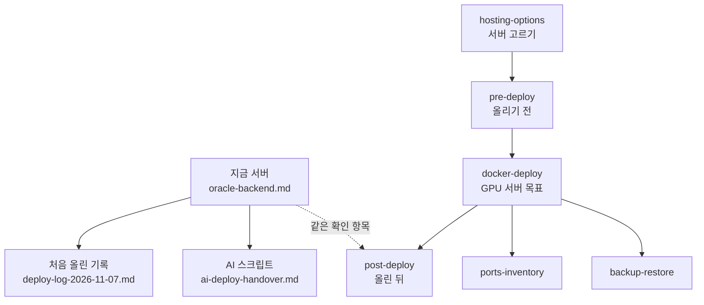
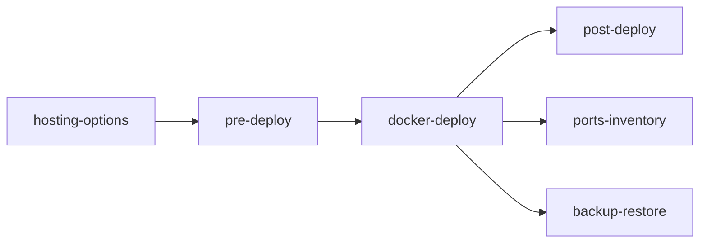

# 배포·포트·운영

배포 전 점검, Compose 배포, 백업, 포트 관련 기록을 모은다. 진입점: [../DEPLOYMENT.md](../DEPLOYMENT.md).

| 파일 | 내용 |
|------|------|
| [../STATUS.md](../STATUS.md) | 코드에 있는 기능과, 지금 공개 주소에서 열리는 범위 |
| [oracle-backend.md](oracle-backend.md) | **지금 운영 중인 서버(Oracle)의 정본**: 상태, 올리기·다시 올리기, 점검, 웹 연결 |
| [../../PortFolio/README.md](../../PortFolio/README.md) | 포트폴리오 사이트(제품 웹이 아님). 공개 주소는 Astro 정적만, 챗봇 서버는 없음 |
| [deploy-log-2026-11-07.md](deploy-log-2026-11-07.md) | 처음 실제로 올린 날의 기록: 결정, 막힌 시도와 원인, 병합, 정리, 남은 일 |
| [ai-deploy-handover.md](ai-deploy-handover.md) · [ai-server-guide.html](ai-server-guide.html) | 같은 VM에 AI(NVIDIA API + CPU Ollama)를 올리는 스크립트 설명 |
| [deploy-guide.html](deploy-guide.html) · [oracle-console-guide.html](oracle-console-guide.html) | 다른 브랜치에서 들어온 대안 안내(한 compose 구성). **지금 서버와 맞지 않으니 그대로 따르지 않는다** |
| [hosting-options.md](hosting-options.md) | 상시 서버 후보와 권장 |
| [pre-deploy.md](pre-deploy.md) | 배포 전 체크 |
| [docker-deploy.md](docker-deploy.md) | GPU 서버(목표) 배포 절차, 서버 조건, 실측 |
| [backup-restore.md](backup-restore.md) | 백업과 복구, 연습 기록 |
| [ports-inventory.md](ports-inventory.md) | 포트 표 (기준: `../plan/CURRENT_STACK.md`) |
| [post-deploy.md](post-deploy.md) | 배포 후 확인 |

> 상태(2026-11-07): **웹은 Vercel, API·DB·AI(대화)는 Oracle Cloud ARM VM에서 운영 중이다**([oracle-backend.md](oracle-backend.md)). 도메인 대신 `sslip.io`를 쓴다. 그림 엔진용 GPU 서버(Hetzner GEX45)는 계약 전이다.

월드코퍼챗(2026-11-06)은 새 서비스가 없어 배포 구성이 같다. 마이그레이션 하나, DB 크기, 콘솔 운영 설정만 본다 → [post-deploy.md](post-deploy.md), [backup-restore.md](backup-restore.md).

<!-- logic-structure -->
## 로직 구조

<!-- logic-mermaid -->

### 운영 문서 순서

