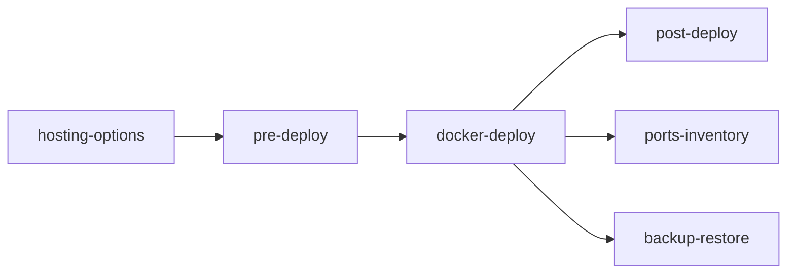

# 배포·포트·운영

배포 전 점검, Compose 배포, 백업, 포트 관련 기록을 모은다. 진입점: [../DEPLOYMENT.md](../DEPLOYMENT.md).

| 파일 | 내용 |
|------|------|
| [hosting-options.md](hosting-options.md) | 상시 서버 후보와 권장 |
| [pre-deploy.md](pre-deploy.md) | 배포 전 체크 |
| [docker-deploy.md](docker-deploy.md) | 운영 배포 절차, 서버 조건, 실측 |
| [backup-restore.md](backup-restore.md) | 백업과 복구, 연습 기록 |
| [ports-inventory.md](ports-inventory.md) | 포트 표 (기준: `../plan/CURRENT_STACK.md`) |
| [post-deploy.md](post-deploy.md) | 배포 후 확인 |

> 상태(2026-11-03): 구성은 만들어 개발 PC에서 시험했다. 서버는 Hetzner GEX45로 정했고 계약 전이다. 도메인은 아직 정하지 않았다.

월드코퍼챗(2026-11-06)은 새 서비스가 없어 배포 구성이 같다. 마이그레이션 하나, DB 크기, 콘솔 운영 설정만 본다 → [post-deploy.md](post-deploy.md), [backup-restore.md](backup-restore.md).

<!-- logic-structure -->
## 로직 구조

```text
hosting-options (서버 고르기) ─▶ pre-deploy (올리기 전 확인) ─▶ docker-deploy (처음 설치·유지)
                                                                      │
                     ports-inventory (포트) ◀─────────────────────────┤
                     backup-restore (백업·복구 연습) ◀────────────────┤
                     post-deploy (올린 뒤 확인) ◀─────────────────────┘
```

<!-- logic-mermaid -->

### 운영 문서 순서


