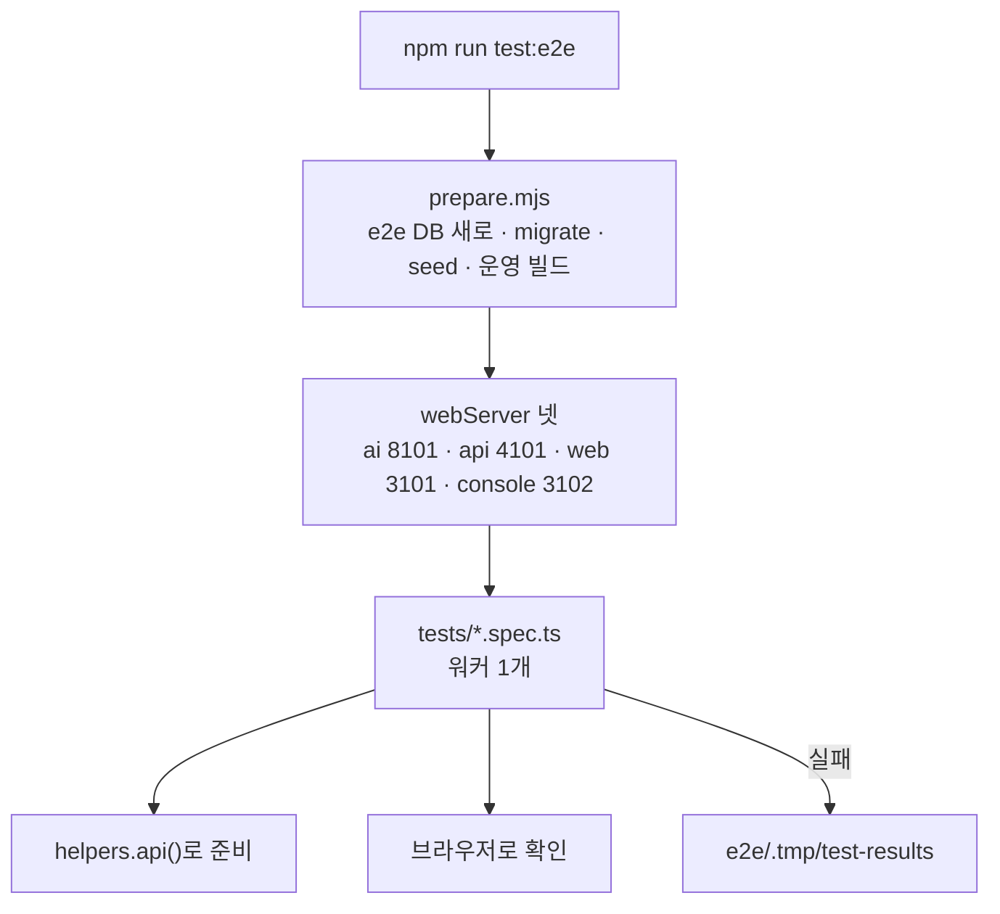
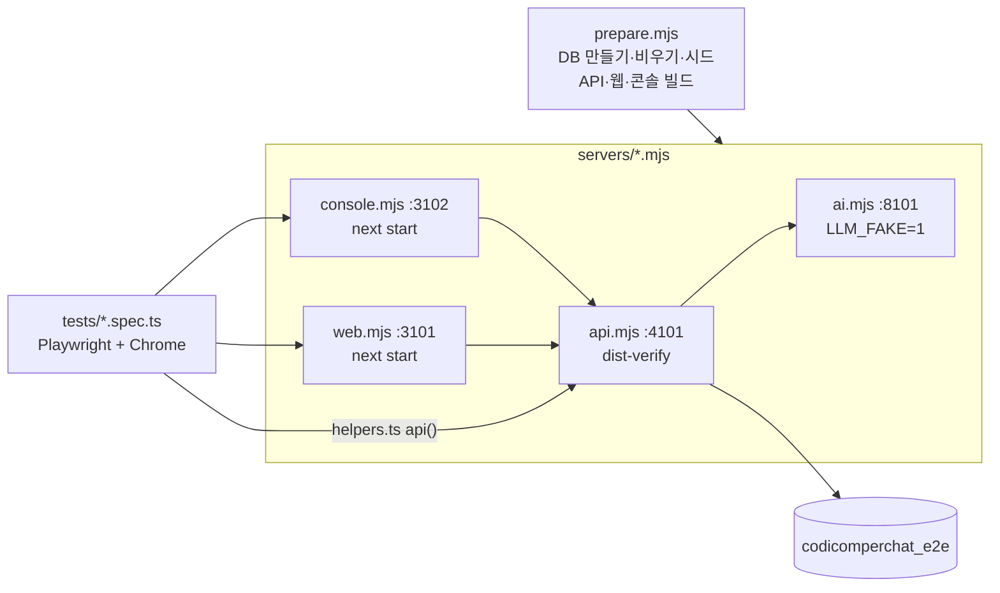

# 웹 자동 테스트 (e2e)

실제 브라우저(Chrome)로 화면 흐름을 돌려, 고친 뒤에 화면이 깨졌는지 바로 알게 한다. LLM은 **가짜**(`LLM_FAKE=1`), 그림 엔진도 **가짜**(작은 그림)라
모델·GPU 없이 돈다. 화면은 이 PC의 운영 빌드(`next build` → `next start`)로 띄운다. 공개 Vercel·Oracle을 치지 않는다. 그 주소에서 열리는 범위는 [../docs/STATUS.md](../docs/STATUS.md). 전체는 빌드를 합쳐 약 5분이고 시험은 약 3분이다(2026-11-04). AI 말투·환각 품질은 여기가 아니라 `services/ai/evals`가 본다.

```bash
npm run test:e2e                              # 전체 (준비 → 서버 3개 기동 → 테스트)
npm run test:e2e -- tests/chat.spec.ts        # 한 파일만
npm run test:e2e -- -g "신고"                  # 이름으로 골라서
E2E_SKIP_BUILD=1 npm run test:e2e -- tests/chat.spec.ts   # 화면 코드를 안 고쳤으면 빌드 건너뛰기
npx playwright show-trace e2e/.tmp/test-results/<실패한 테스트>/trace.zip   # 실패 추적
```

필요한 것: 로컬 PostgreSQL(개발 DB와 같은 서버), 설치된 Chrome, `services/ai/.venv`(FastAPI 의존성). 포트와 DB는 개발 환경과 겹치지 않아 개발 서버를 켜 둬도 된다. 그림 엔진은 메모리를 많이 쓰니 끈다.

<!-- logic-structure -->
## 로직 구조

```text
npm run test:e2e
   │
   ▼
prepare.mjs ─ e2e DB(codicomperchat_e2e) 새로 만들기 → migrate deploy → seed
   │          운영 빌드 (.next-e2e · dist-verify), E2E_SKIP_BUILD=1이면 건너뜀
   ▼
playwright.config.ts webServer
   ├─ servers/ai.mjs      :8101  LLM_FAKE=1 · 가짜 그림 엔진
   ├─ servers/api.mjs     :4101  RATE_LIMIT_SCALE 크게 · 메일은 파일로
   ├─ servers/web.mjs     :3101  next start
   └─ servers/console.mjs :3102
   ▼
tests/*.spec.ts (워커 1개, 순서대로)
   준비는 helpers.ts의 api()로 Nest 직접 → 확인할 것만 브라우저로
   ▼
실패 → e2e/.tmp/test-results (화면·추적)
```

<!-- logic-mermaid -->

### 실행 순서



## 구조



`npm run test:e2e:adult-off`는 `run-adult-off.mjs`가 `ADULT_MODE=off`로 서버를 다시 띄워 `adult-off.spec.ts`만 돌린다. 이 시험은 보통 실행에서 `testIgnore`로 빠진다.

## 개발 환경과 겹치지 않는 구조

| | 개발 | e2e |
|--|------|-----|
| 웹 | 3000, `.next` (`next dev`) | **3101**, `apps/web/.next-e2e` (`next start`) |
| API | 4000, `dist` | **4101**, `dist-verify` |
| AI | 8000, 실제 Ollama | **8101**, 가짜 LLM |
| DB | `codicomperchat` | **`codicomperchat_e2e`** (같은 서버, 없으면 만든다) |
| 지식 파일 | `apps/api/data/personas` | `e2e/.tmp/personas` |

`e2e/prepare.mjs`가 매번 먼저 돈다: DB 만들기 → 마이그레이션 → **전체 비우기** → 공식 캐릭터(`e2e-official`) 심기 → API 빌드.
DB 주소는 `apps/api/.env`의 `DATABASE_URL`에서 데이터베이스 이름만 바꿔 쓴다(비밀번호를 코드에 두지 않는다). 다른 DB를 쓰려면 `E2E_DATABASE_URL`.

## 무엇을 보나

| 파일 | 흐름 |
|------|------|
| `auth.spec.ts` | 보호된 페이지, 가입→로그아웃→로그인, 잘못된 비밀번호, 내 프로필 만들기 |
| `email.spec.ts` | 인증 메일·비밀번호 찾기, 가입 여부 비노출, 비밀번호 변경 시 다른 기기 로그아웃 |
| `account.spec.ts` | 회원 탈퇴(비밀번호·확인 문구, 발행 캐릭터 내림) |
| `chat.spec.ts` | 프로필 필수·고정, 새로하기(저장/안 함)·이어하기, 엑스트라 적용, 지난 이야기·친밀도·복선 |
| `commands.spec.ts` | 대화 명령어(/다시 /계속 /되돌리기 /상황 /도움말) |
| `format.spec.ts` | 글 꾸미기(기울임 회색·굵게·취소선·코드·제목·인용·상자·정보창·@이름·@: 나레이션), 글 속 HTML은 실행되지 않음 |
| `models.spec.ts` | 모델 고르기, 강화 무료(하루 30번 → 그 뒤 1번 10 코레딧), 프리미엄 코레딧·나이 확인, 출석 |
| `studio.spec.ts` | 자동 저장, 3턴 테스트→발행, 카드 수정 시 테스트 무효, 말투 샘플, AI 초안(비밀 칸 제외), 프롬프트 연장, 초상 업로드·검사·접근, 공개 범위 |
| `moderation.spec.ts` | 초상 자동 검수(승인·애매→운영자·반려) |
| `reports.spec.ts` | 신고→운영자 내리기→숨김·주인 안내→복구, 신고 기각 |
| `plan.spec.ts` | 요금 등급(프로 긴 글 3배), 만료 처리 |
| `billing.spec.ts` | 시험 결제·승인 검증·환불·운영자 등급 변경, 눌러서 프로로 바꾸기 |
| `console.spec.ts` · `console-birthdate.spec.ts` | 운영 콘솔 로그인·대시보드·캐릭터 관리·CSP, 생년월일 고치기 |
| `content-reports.spec.ts` | 그림 신고 → 콘솔의 그림 표시·접근 차단·문제없음·계정 정지와 해제 |
| `adult-off.spec.ts` | `ADULT_MODE=off` 서버 전용(`npm run test:e2e:adult-off`). 성인 입구가 없고 서버가 막는다 |
| `operations.spec.ts` | 오퍼레이션 4종(심리 탐구·일기·메시지·커뮤니티), 코디포토넷(만들기·대사 고르기·코레딧), **수위(성인 확인·성인 가드·미성년자 설정 거절·동의 철회·열림 상자)** |
| `webtoon.spec.ts` | 웹툰(콘티 무료·컷당 45·이중 그리기 방지·남의 컷 404·성인 가드·화면) |
| `quest.spec.ts` | 비밀 퀘스트(진행·문턱·중복 보상 방지·공방 직접/AI 제작·유저 캐릭터 보상 없음·화면) |
| `popular.spec.ts` | 인기 순위 |
| `persona-recommend.spec.ts` | 추천 프로필(그대로 시작·나레이션 시작 장면·고쳐서 쓰기·같은 이름 재사용·API 응답) |
| `portrait-ai.spec.ts` | 공방 AI 초상 후보(25 코레딧·값 검증·여러 장 비교·고른 그림만 저장·화면) |
| `studio-recommend.spec.ts` | 공방의 추천 프로필 칸(발행·비우기·테스트 유지·글자 수) |
| `mypage.spec.ts` · `theme.spec.ts` | 마이페이지·설정, 테마(한국 시각 자동 전환·영구 설정) |
| `security.spec.ts` | 보안 헤더·엄격한 CSP(nonce)·CSP 위반 보고·약한 비밀번호 거절·약관 본문 |

공식 캐릭터는 `prepare.mjs`가 셋 심는다: `e2e-official`(퀘스트 없음), `e2e-quest`(비밀 퀘스트 있음, 친밀도 40), `e2e-rec`(추천 프로필 있음). 가짜 LLM이라 퀘스트 판정은 대사의 표시로 정한다(`[부탁]`=건넴, `[해냄]`=달성).

### 월드코퍼챗 (`tests/worlds.spec.ts`, 2026-11-06)

6개, `test.describe.serial`. 운영 설정(이벤트 확률·간격)을 바꿨다가 끝에 되돌린다. 가짜 LLM: 진행자 답 고정 한 줄, 파트 판정은 유저 말의 `[파트완료]`. 가짜 그림 검수: 그림 바이트에 `E2E-REVIEW`면 대기, `E2E-BLOCK`이면 거절. 이벤트 종류는 무작위라 화면 시험은 보이는 버튼(`event-choice`·`event-roll`·`event-throw`·포기)에 맞춰 한 번 한다. 콘솔 화면은 `URLS.console`을 붙여 연다. 전체 e2e 123개(파일 26개) + 성인 끔 1개.

## 쓰는 요령

- 준비(계정·초안·데이터)는 `helpers.ts`의 `api()`로 Nest를 직접 부르고, **화면에서 확인할 것만** 브라우저로 한다. 그래야 빠르고 덜 깨진다.
- 이메일 칸은 브라우저가 아이디 부분의 한글을 막는다 → 가입 이메일은 영문·숫자 (`signup()`이 알아서 만든다).
- 첫 로딩 때 하이드레이션이 늦을 수 있다. 폼을 누르기 전에 `await page.waitForLoadState("networkidle")`.
- 서버 액션 뒤에 바로 다른 페이지로 이동하지 말고, 끝났다는 신호(URL·문구)를 기다린다.
- 테스트는 한 번에 하나씩(같은 DB). 테스트마다 새 계정을 만들어 서로 간섭하지 않는다.
- 일부러 규칙을 고장 내 보면(예: 비공개 캐릭터를 모두에게 보이게) 관련 테스트가 실패하는 것을 확인했다.
