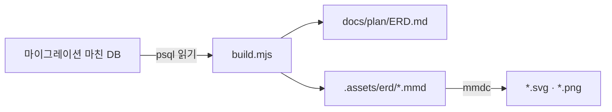

# ERD 만들기

[docs/plan/ERD.md](../../docs/plan/ERD.md)의 그림·표와 `docs/.assets/erd/`의 그림을 **실제 DB 구조**에서 다시 만든다. DB는 읽기만 한다.

```bash
# 1) 마이그레이션을 마친 DB를 준비한다. 개발 DB를 건드리지 않게 빈 DB를 하나 만들어 쓴다
createdb codicomperchat_erd
cd apps/api && DATABASE_URL=postgresql://localhost:5432/codicomperchat_erd npx prisma migrate deploy && cd ../..

# 2) ERD.md 구간과 .mmd를 새로 쓴다 (psql이 PATH에 있어야 한다)
node scripts/erd/build.mjs --db postgresql://localhost:5432/codicomperchat_erd

# 3) 그림 (한글 글꼴이 있는 곳에서. PNG는 2배로)
for f in overview account chat ops world standalone; do
  npx -y @mermaid-js/mermaid-cli@11.4.2 -c scripts/erd/mermaid.json -b white -i docs/.assets/erd/$f.mmd -o docs/.assets/erd/$f.svg
  npx -y @mermaid-js/mermaid-cli@11.4.2 -c scripts/erd/mermaid.json -b white -s 2 -i docs/.assets/erd/$f.mmd -o docs/.assets/erd/$f.png
done

# 4) GitHub에서 그려지는지
node scripts/check-mermaid.mjs
```

2026-11-07 첫 생성은 클라우드 컨테이너에서 했다: PostgreSQL 16 빈 DB에 `migration.sql` 34개를 `psql -v ON_ERROR_STOP=1`로 차례로 적용, 글꼴은 나눔고딕, PNG는 32색으로 줄여 용량을 낮췄다.

<!-- logic-structure -->
## 로직 구조

```text
migrations → (빈 DB) → build.mjs가 읽음 → ERD.md 구간 · *.mmd → mmdc → *.svg · *.png
```

<!-- logic-mermaid -->


