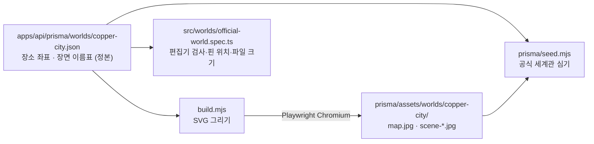

# 공식 세계관 그림

`node scripts/world-art/build.mjs` — 공식 세계관 「코퍼 시티: 멈춘 시계탑」의 지도 1장과 장면 그림 4장을 SVG로 그려 JPEG로 굽는다.

<!-- logic-structure -->
## 로직 구조

- 지도는 화면(코퍼맵)과 같은 **16:10**(1600×1000)이다. 핀과 이름표는 화면이 좌표대로 겹쳐 그리므로 그림에는 장소 이름을 넣지 않고 건물만 좌표 자리에 그린다.
- 장소를 옮기면 JSON의 `x`·`y`만 고치고 다시 굽는다. 시드는 이미 있는 세계관의 글을 덮지 않으므로, 운영 DB에서 지도를 바꾸려면 콘솔·편집기에서 올린다.
- 한 장에 290KB 이하(`WORLD_IMAGE_MAX_BYTES`)가 되도록 JPEG 품질을 88부터 낮춰 가며 굽는다.
- `playwright-core`가 기대하는 브라우저가 없으면 이미 받아 둔 `ms-playwright/chromium-*`을 찾아 쓴다.
