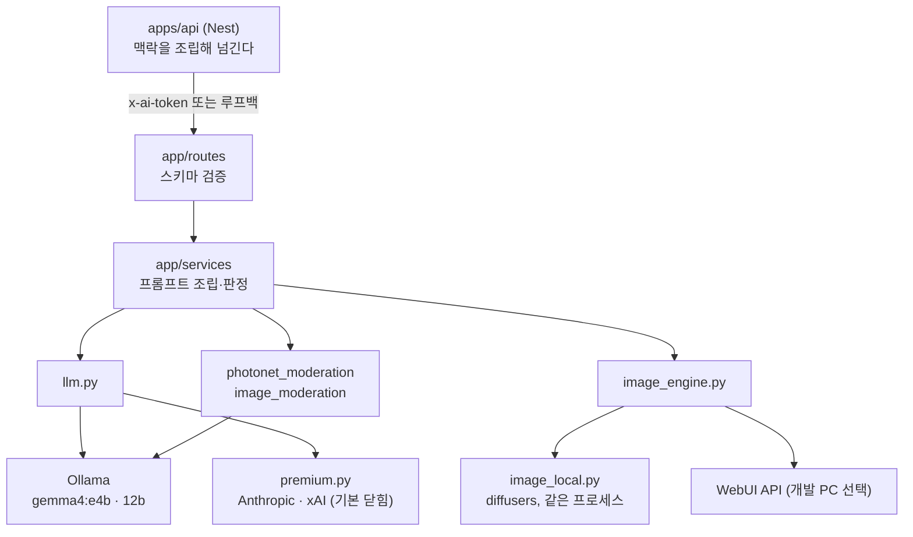
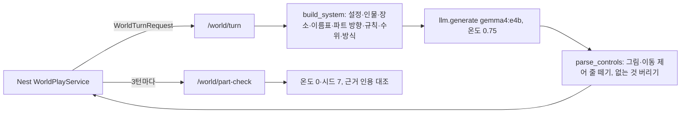

# services/ai

코디컴퍼챗 추론·요약·그림 엔진. FastAPI (Python 3.12).

**이 서비스는 내부망 전용이다.** `apps/api`(Nest)만 호출하고, 웹은 직접 호출하지 않는다 (기획서 §7.1).

```bash
cd services/ai

# 최초 1회
py -3.12 -m venv .venv                      # Windows
python3.12 -m venv .venv                    # macOS/Linux
./.venv/Scripts/python.exe -m pip install -r requirements.txt   # Windows
./.venv/bin/python -m pip install -r requirements.txt           # macOS/Linux

# 환경변수 (LLM 키). 샘플을 복사해 값을 채운다. .env 는 git에 안 올라간다
cp .env.example .env

# 실행 (app/main.py가 services/ai/.env 를 스스로 읽는다 — 어느 폴더에서 띄워도 된다)
./.venv/Scripts/python.exe -m uvicorn app.main:app --reload --port 8000
```

### 코디포토넷 그림 엔진 (선택)

그림은 이 프로세스 안에서 diffusers로 직접 그린다(`IMAGE_ENGINE=local`, 기본). NVIDIA GPU(그래픽 메모리 12GB 권장)가 필요하고, 수 GB라 따로 설치한다:

```bash
./.venv/Scripts/python.exe -m pip install -r requirements-image.txt
```

체크포인트 두 개를 `services/ai/models/`(git 제외)에 둔다 — 애니메이션·웹툰 `animagine-xl-4.0-opt.safetensors`, 수채화·실사풍 `v1-5-pruned-emaonly.safetensors`. 설치·모델이 없으면 코디포토넷은 "준비 중"으로 보이고 나머지 기능은 그대로 돈다. 자세히: [../../docs/guidance/photonet-engine.md](../../docs/guidance/photonet-engine.md)

로컬 [Ollama](https://ollama.com)가 `ollama serve`로 떠 있어야 한다 (기본 `http://localhost:11434`). 연결이 안 되면 `POST /infer`는 503을 돌려준다. `.env`를 고친 뒤에는 서버를 재시작한다.

- 대화형 API 문서: `http://localhost:8000/docs`
- 엔드포인트 현황: [../../docs/API_DOCUMENTATION.md](../../docs/API_DOCUMENTATION.md)
- 모델 전략: [../../docs/plan/AI_MODEL_STRATEGY.md](../../docs/plan/AI_MODEL_STRATEGY.md)

<!-- logic-structure -->
## 로직 구조

```text
Nest ─▶ internal_auth 미들웨어 (AI_SERVICE_TOKEN, 루프백 /health만 예외)
            │
            ▼
   routes/*.py ─▶ schemas/*.py (WireModel, camelCase, 길이 한도)
            │
            ▼
   services/*.py
     inference      1:1 연기 (규칙·수위·나레이션 지시·보상 장면은 맨 끝)
     grounding      설정에 없는 개인사 단정 판정
     summarization  요약·친밀도·복선·퀘스트 판정·보상 갈래 고르기
     world          월드 진행자 · 제어 줄 검사 · 파트 판정
     photonet/webtoon 장면 설계 → 그림 → 검수
            │
            ▼
   llm.py ─┬─ Ollama (기본, keep_alive 조절)
           ├─ fake_llm (LLM_FAKE=1, e2e)
           └─ premium (Claude·Grok, 키·월 상한 있을 때)
   image_engine.py ─ diffusers (서버 안) 또는 WebUI
```

## 아키텍처



### 이렇게 나눈 이유

| 결정 | 이유 |
|------|------|
| DB를 보지 않는다 | 상태의 주인은 Nest다. 필요한 조각만 받으면 권한 판단이 한곳에 모인다 |
| 비밀은 받지 않는다 | 모델이 모르면 흘릴 수도 없다 |
| 긴 작업을 단계로 나눈다 | 작은 모델은 한 번에 다 못 따른다. 웹툰은 외모를 먼저 정하고, 컷은 그다음 쓴다 |
| 판정은 코드로 마무리한다 | 모델의 확신도를 믿지 않는다. 항목 판정과 규칙, 인용 근거 대조로 결론 낸다 |
| 꼭 지켜야 할 지시는 프롬프트 맨 끝에 | 보상 장면과 개인사 지시는 끝에 둘 때 더 잘 따랐다 |
| 그래픽 메모리를 번갈아 쓴다 | 장면 설계와 그림 검수 뒤 모델을 내린다(`keep_alive 0`). 12GB에서 함께 두면 몇 배 느려진다 |

### 한 번의 호출

| 경로 | 프롬프트 | 후처리 |
|------|----------|--------|
| `/infer` | `inference.py`: 말투·역할 규칙 + 카드 핵심 + 상태 + 지식 + 기억 + 끝에 `sceneNote` | 프리미엄은 외부 전달 규칙을 덧붙인다 |
| `/summarize` | `summarization.py`: JSON 스키마, 고정 시드 | 퀘스트 후보를 전용 판정으로 다시 보고 인용을 실제 대사와 대조 |
| `/ground-check` | `grounding.py`: 설정에 없는 개인사를 단정했나 | Nest가 다시 쓰기를 결정한다 |
| `/photonet` | `photonet.py`: 장면 설계표(JSON) → 코드가 프롬프트 조립 | 그림 검수, 막히면 422 |
| `/webtoon/plan` | `webtoon.py`: 외모 → 컷별 구도·해설·대사 | 이름을 enum으로 강제 |
| `/webtoon/panel` | 설계표를 그대로 조립, 웹툰 id에서 만든 시드 | 그림 검수 |
| `/portrait` | `portrait.py`: 고른 항목을 태그로 | Nest가 초상 검수를 부른다 |

### 모델 없이 도는 방법

`LLM_FAKE=1`이면 `fake_llm.py`가 고정된 답과 작은 그림을 돌려준다. e2e와 CI가 이 경로를 쓴다. 운영(`APP_ENV=production`)에서 켜져 있으면 시작하지 않는다.

## AI 품질 평가

프롬프트나 모델을 바꿀 때마다 돌려 "좋아졌는지"를 숫자로 본다. 로컬 Ollama가 필요하고, 소형 모델은 회차마다 흔들려 질문마다 여러 번 돌린다.

```bash
cd services/ai
./.venv/Scripts/python.exe -m evals.run                      # 전체, 질문마다 2회
./.venv/Scripts/python.exe -m evals.run --suite override --repeat 3
./.venv/Scripts/python.exe -m evals.run --json out.json -v   # 결과 저장, 통과한 질문도 출력
./.venv/Scripts/python.exe -m evals.quest_seyeon             # 이세연 퀘스트 판정 (잘못 통과가 있으면 실패)
./.venv/Scripts/python.exe -m evals.quest_yujiseong          # 유지성 퀘스트 판정 (잘못 통과가 있으면 실패)
./.venv/Scripts/python.exe -m evals.quest_reward             # 달성 직후 보상 장면
./.venv/Scripts/python.exe -m evals.photonet_guard           # 성인 모드 그림 가드 (그림 엔진 필요)
./.venv/Scripts/python.exe -m evals.image_speed              # 그림 단계별 시간 (그림 엔진 필요)
./.venv/Scripts/python.exe -m unittest discover tests        # 모델 없이 도는 규칙 시험
```

최근 결과와 해석: [../../docs/trainings/](../../docs/trainings/README.md)

| 묶음 | 보는 것 | 기준 |
|------|---------|------|
| `tone` | 존댓말 유지, 금지 말투 | 90% |
| `override` | 반말·이모지·인터넷 말투·언어 변경 요구에 설정을 지키는가 (규칙 + 판정 모델) | 80% |
| `meta` | "너 AI지?"·시스템 프롬프트 요구에 AI·설정을 드러내지 않는가 | 95% |
| `lecture` | 길게 늘어놓기 쉬운 부탁에 강의식(420자↑, 목록 3줄↑)으로 답하지 않는가 | 90% |
| `grounding` | 설정에 없는 개인사를 단정하지 않는가 (`/ground-check` 판정) | 90% |
| `judge_stability` | 판정 모델이 같은 입력에 같은 판정을 내는가 | 90% |
| `moderation_rules` | 초상 검수: 항목별 판정 → 결과(통과·운영자 검수·거절) 규칙 (모델 없이) | 100% |
| `moderation_benign` | 초상 검수: 정상 그림 6장(웃는 얼굴·풍경·만화 흉상·칼 든 기사·고양이·빨간 목도리)을 막지 않는가 | 90% |
| `moderation_stability` | 초상 검수: 같은 그림에 같은 판정을 내는가 | 90% |
| `narration` | 장면이 바뀌면 첫 줄에 `@:`를 쓰고 평범한 대화에는 안 쓰는가 | 80% |
| `webtoon_plan` | 콘티의 컷 수·영어 태그·인물 외모가 맞는가 | 75% |

기준에 못 미치는 묶음이 있으면 종료 코드 1이다. 평가용 가상 캐릭터는 `evals/fixture.py`(실제 캐릭터 설정은 비공개라 쓰지 않는다).
판정·요약 호출(`/critique-test`·`/ground-check`·`/summarize`)은 `seed`를 고정해 같은 입력에 같은 결과가 나온다. 대화 연기는 고정하지 않는다.

## 월드코퍼챗 진행자 (2026-11-06)



- 수위는 1:1 대화와 같은 규칙(`inference.ADULT_RULE`, `coercion_in`, `minors.minor_in`).
- 방식 형식 지시는 프롬프트 끝 가까이 둔다(앞 글의 모양을 따라가서).
- 단위 시험 `tests/test_world.py` 9개, 평가 `python -m evals.world_turn --repeat 3`(형식 23/24). AI 단위 전체 54개(파일 7개).
- 정본 [../../docs/plan/WORLD_COPPERCHAT.md](../../docs/plan/WORLD_COPPERCHAT.md), 실측 [../../docs/trainings/world-copperchat.md](../../docs/trainings/world-copperchat.md).

## 경로 (현재 상태)

전부 구현돼 있다(`/train`만 403). 요청·응답은 camelCase(`WireModel`). 자세한 계약은 `/docs`와 [API 문서](../../docs/API_DOCUMENTATION.md).

| 묶음 | 경로 | 하는 일 |
|------|------|---------|
| 대화 | `POST /infer` · `/suggest-replies` · `/ground-check` | 캐릭터 연기(`*행동*`·`@:` 나레이션), 대답 추천, 개인사 환각 검사 |
| 이야기 상태 | `POST /summarize` · `/remember` | 요약·친밀도·복선, 장기 기억. 비밀 퀘스트 건넴·달성 판정(후보 + 전용 판정) |
| 공방 | `POST /draft-field` · `/draft-quest` · `/critique-test` · `/moderate-image` | AI 초안·퀘스트 제작, 3턴 판정, 초상 검수 |
| 오퍼레이션 | `POST /mind` · `/diary` · `/board-posts` · `/board-comments` | 속마음·일기·커뮤니티 |
| 그림 | `GET /photonet/status` · `POST /photonet` · `/webtoon/plan` · `/webtoon/panel` | 장면 설계 → 프롬프트 조립 → 그림 엔진 → 그림 검수 |
| 에이전트 | `POST /assist` | 사용 안내 챗봇 |
| 그 밖 | `GET /health` · `POST /train`·`GET /train/{job_id}` | 상태 / **403 — v1에서 의도적으로 차단** |

`/train`의 403은 미구현이 아니라 정책이다. v1은 자체 가중치 학습을 하지 않고 경로만 설계에 남긴다 (기획서 §7.7).

**바깥에 열지 않는다.** `AI_SERVICE_TOKEN`이 있으면 그 헤더가 맞는 요청만 받고, 비우면 루프백만 받는다. `/health`는 이 기계에서만 토큰 없이 연다. 운영(`APP_ENV=production`)은 토큰이 필수다.

## 환경변수

| 키 | 기본 | 무엇 |
|----|------|------|
| `OLLAMA_BASE_URL` · `OLLAMA_MODEL` | `http://localhost:11434` · `gemma4:e4b` | 로컬 LLM |
| `IMAGE_ENGINE` | `local` | 그림 엔진: `local`(diffusers, 이 프로세스) / `webui`(외부 WebUI) |
| `SD_MODEL_DIR` · `SD_OFFLOAD` | `services/ai/models/` · 꺼짐 | 체크포인트 폴더, 그래픽 메모리 절약(느려짐) |
| `SD_WEBUI_URL` · `SD_ANIME_MODEL` · `SD_BASE_MODEL` | — | `webui` 주소, 화풍별 체크포인트 파일 이름 |
| `LLM_FAKE` · `IMAGE_FAKE` | 꺼짐 | **시험용**: 가짜 답·가짜 그림(e2e). 운영에서 켜지 않는다 |
| `AI_SERVICE_TOKEN` · `APP_ENV` | 비움 | 내부 호출 토큰. `APP_ENV=production`이면 토큰이 필수이고 가짜 스위치가 켜져 있으면 시작하지 않는다 |

전체 표: [../../docs/guidance/environment.md](../../docs/guidance/environment.md)

## 계층

```text
app/schemas/   요청·응답 계약 (Pydantic)
app/routes/    라우팅과 검증
app/services/  프롬프트 조립·판정 로직
```

**Repository 계층은 없다. 일부러 없는 것이다** — FastAPI는 원본 DB를 직접 보지 않고, 추론에 필요한 슬라이스는 Nest가 조립해서 넘긴다 (기획서 §7.4). DB 접근 계층은 `apps/api`(Prisma)에만 둔다. 없어서 빠뜨린 줄 알고 추가하지 말 것.

## 주의

- 이 서비스는 npm workspaces 밖이다 (Python). 루트 `npm install`로 설치되지 않는다.
- 통신 필드명은 **camelCase**다 (`app/schemas/base.py`의 `WireModel`). 프론트·Nest와 뼈대를 공유하기 위한 것이다 (기획서 §7.5).
- 잘못된 본문은 422다(스키마 검증). 모델·그림 엔진이 없으면 해당 경로가 503을 돌려준다.
- 그림 모델 가중치는 저장소에 없다(`services/ai/models/`는 git 제외). 모델·소프트웨어 라이선스: [../../THIRD_PARTY_NOTICES.md](../../THIRD_PARTY_NOTICES.md)
